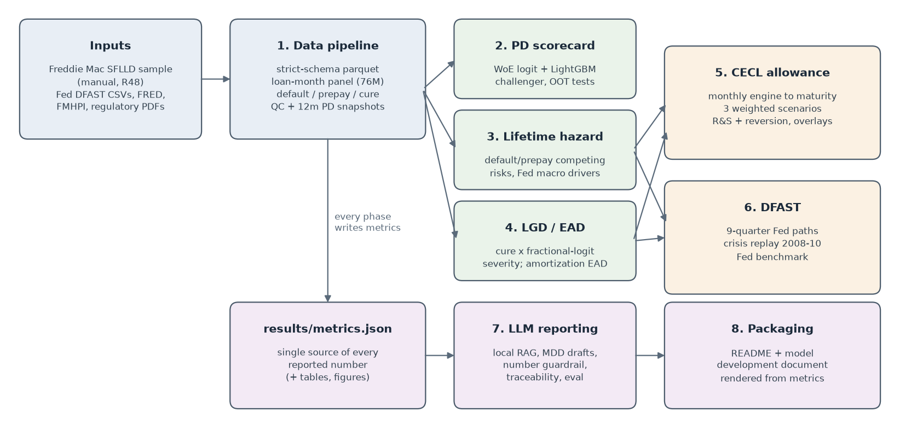
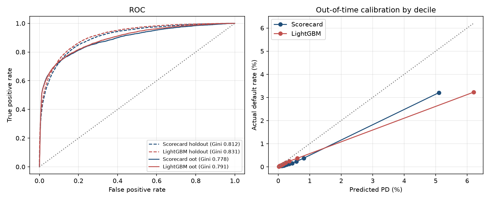
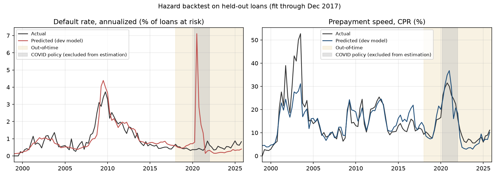
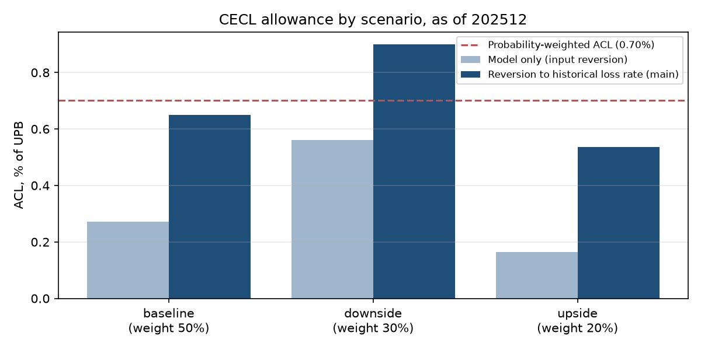
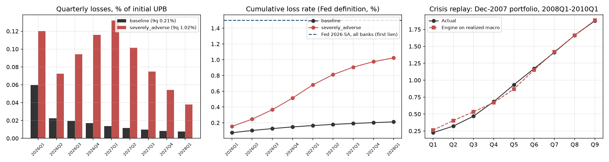

# CECL & DFAST Credit Loss Engine

Loan-level **CECL allowance** and **DFAST stress-loss** models for US single-family mortgages, built on the
Freddie Mac Single-Family Loan-Level Dataset, with a local LLM reporting layer for model documentation.

*This README is generated by `scripts/build_reports.py` from `results/metrics.json`: no number below is typed by hand.*



## Headline results

| | |
|---|---|
| Data | 1,374,984 loans, 76,002,480 loan-months (1999–2026), every value strictly type-checked; loss identity reconciles for 19,681 of 19,681 liquidations |
| 12-month PD scorecard | out-of-time Gini **0.778** (95% CI 0.767–0.788), KS 0.632; LightGBM challenger 0.791 |
| Lifetime hazard (default + prepay) | out-of-time prepayment actual/predicted **1.02**; unemployment +2 pts → defaults ×1.56 |
| LGD / EAD | out-of-time severity 32.2% predicted vs 23.5% actual; EAD actual/scheduled 1.003 |
| **CECL allowance** (as of 202512) | **0.70% of UPB**, probability-weighted (model only: 0.34%) |
| **DFAST** severely adverse, 9 quarters | **1.02%** loss rate vs 0.21% baseline (Fed all-bank first-lien: 1.5%) |
| Crisis replay (Dec-2007 book through 2008–10) | predicted 1.88% vs actual 1.88% |
| LLM reporting (local) | 52-question regulatory RAG eval: retrieval hit@5 88%; number guardrail + logged human review |

## Charts

| | |
|---|---|
|  |  |
|  |  |

## What is in here

| Phase | What it does | Key decisions |
|---|---|---|
| 1. Data | Pipe-delimited files → typed parquet; loan-month panel; default/prepay/cure events; QC | 90+ DPD default excluding forbearance months (D-004); yearly PD snapshots (D-007) |
| 2. PD | WoE/IV binning, logistic scorecard with loan-clustered SEs, LightGBM + SHAP challenger | Era-proxy features removed using training data only (D-019) |
| 3. Hazard | Monthly multinomial logit: survive / default / prepay, Fed-consistent macro drivers | COVID policy months excluded from estimation (D-024) |
| 4. LGD/EAD | Cure probability × fractional-logit severity; scheduled-balance EAD | Real (HPI-deflated) loan size (D-041) |
| 5. CECL | Monthly engine to maturity, 3 weighted scenarios, R&S + reversion, delinquency overlays | Reversion to historical loss rate is the biggest judgment (D-035) |
| 6. DFAST | Fed 2026 paths over 9 quarters, crisis replay, downturn-LGD sensitivity | Servicing-regime assumption reported both ways (D-040) |
| 7. LLM | Local RAG over regulatory PDFs, MDD drafting, number guardrail, traceability matrix, eval | Guardrail checks provenance, not meaning: human review required (D-047) |

Full decision log with rejected alternatives: [DECISIONS.md](DECISIONS.md).
Model development document: [docs/mdd/model_development_document.md](docs/mdd/model_development_document.md) (PDF alongside).

## Getting the data

Raw data is **never committed** (`data/` is gitignored): the Freddie Mac terms forbid redistribution.

1. **Freddie Mac sample files** (free registration): sign in to Clarity Data Intelligence at
   https://claritydownload.fmapps.freddiemac.com/CRT/ (linked from
   https://www.freddiemac.com/research/datasets/sf-loanlevel-dataset), download `sample_1999.zip` … `sample_2026.zip`
   (**sample** files, not the full dataset), and unzip each into `data/raw/freddie/sample_YYYY/`.
   Built on **Release 48** (October 2026); the schema in `src/cecl/data/schema.py` fails loudly if the layout changes.
2. **Everything else** is scripted: `make download` fetches the Fed DFAST files, FRED series, the Freddie Mac house
   price index, and the regulatory documents, with SHA-256 hashes in `data/raw/manifest_public.json`.

## Running

Requires Python 3.12 via [uv](https://github.com/astral-sh/uv); Phase 7 also needs [Ollama](https://ollama.com)
with `qwen3:8b` and `nomic-embed-text` pulled.

```bash
make setup
make download
make all        # phases 1-6 + tests (about 45 minutes on a laptop)
make llm        # phase 7: local LLM documentation layer (about an hour)
make reports    # render README and the model development document from metrics.json
```

Every parameter, path, URL and the random seed live in `config.yaml`. The raw-to-parquet conversion takes
60 s with 1.0 GB peak memory.

## Known limitations

- GSE conforming loans only; post-2014 forbearance flags only; no refreshed borrower data.
- The hazard runs hot in benign years (clean-loan actual/predicted 0.48 in calibration years): conservative.
- LGD is conservative in 2017–2021 and below 2008 peak LGD under stress unless the servicing-regime assumption is switched off.
- The CECL allowance depends heavily on the historical-loss window used for reversion (see the sensitivity table in the MDD).
- The LLM guardrail verifies number provenance, not meaning; drafts are inputs to human-written documentation.
