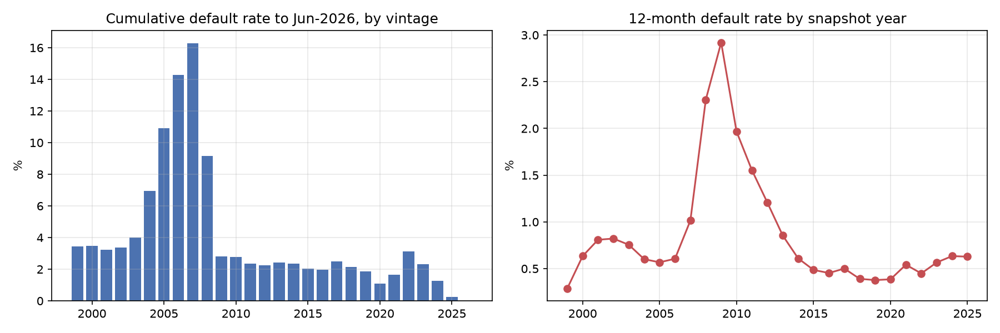
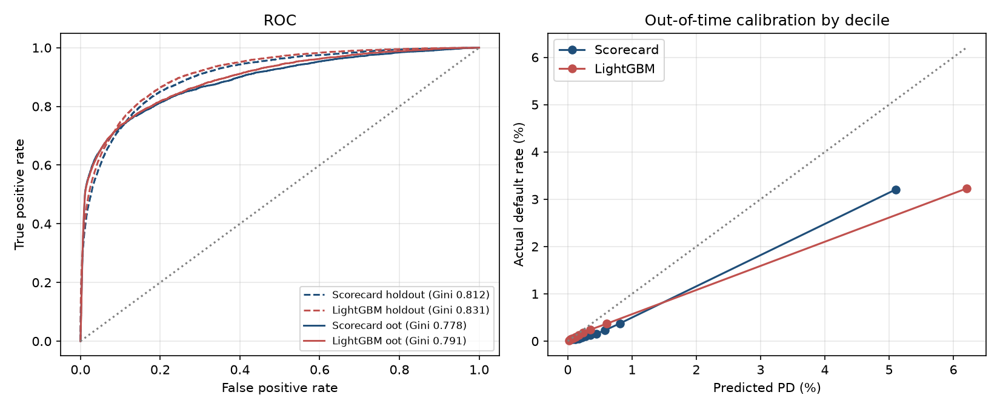
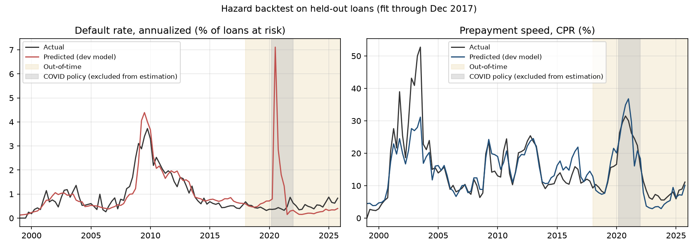
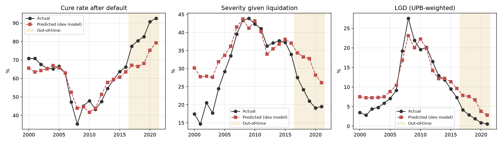
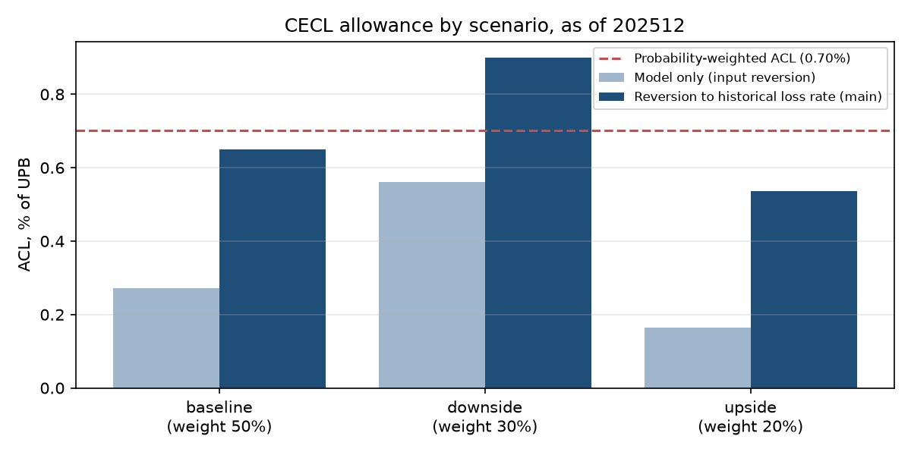
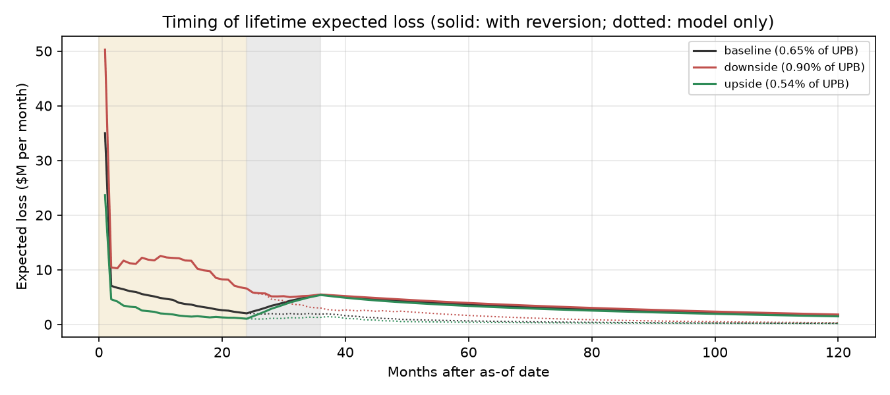
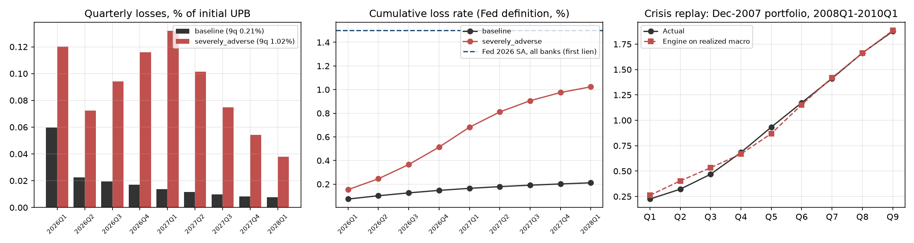

# Executive summary

This document describes a loan-level credit loss engine for US first-lien single-family mortgages, used for two purposes:
the **CECL allowance** (ASC 326) and **DFAST-style supervisory stress projections**. Both uses share one set of models:

- a **12-month PD scorecard** (WoE logistic regression) used for ranking and monitoring;
- a **lifetime competing-risk hazard** for monthly default and prepayment, driven by the Federal Reserve's own scenario variables;
- a two-part **LGD** model (probability of cure × fractional-logit severity) and an **EAD** equal to the scheduled amortization balance;
- a monthly **projection engine** combining them to loan maturity.

**Key results.**

- **CECL:** the probability-weighted allowance is **0.70% of UPB** on 347,613 loans. The model-only allowance (without reversion to historical loss rates) is 0.34%.
- **DFAST:** under the 2026 severely adverse scenario, the 9-quarter loss rate is **1.02%**, against 0.21% under the baseline. The Federal Reserve's all-bank first-lien figure is 1.5%.
- **Validation evidence:**
  - out-of-time scorecard Gini 0.778
  - out-of-time prepayment actual/predicted 1.02
  - a replay of the 2008–2010 crisis reproducing realized losses (1.88% predicted vs 1.88% actual)
  - an untouched Jan–Jun 2026 backtest

**Most material judgments:**

- the historical loss window used for CECL reversion (D-035), which moves the allowance more than any other parameter;
- the post-2013 servicing-regime assumption in LGD (D-031, D-040);
- the exclusion of COVID policy months from hazard estimation (D-024).

Known limitations are in Section 9.

# 1. Purpose, scope and use

**Intended use.** Estimate lifetime expected credit losses for the CECL allowance and project 9-quarter credit losses under
supervisory scenarios, for a portfolio of conforming fixed- and adjustable-rate first-lien mortgages.

**In scope:** loan-level PD, prepayment, LGD, EAD; scenario-conditional projection; allowance and stress-loss aggregation.

**Out of scope:**

- jumbo, subprime, HELOC and junior liens;
- pre-provision net revenue, capital ratios and balance-sheet dynamics;
- quantified qualitative adjustments (Q-factors);
- independent validation, which a model developer cannot perform on their own model.

**Model risk tier (proposed).** High materiality: the model drives a financial-statement estimate and a regulatory exercise
(SR 26-2 materiality: exposure and purpose).

# 2. Data

## 2.1 Sources

| Source | Content | Use |
|---|---|---|
| Freddie Mac SFLLD, sample files (Release 48) | 1,374,984 loans, monthly performance through 202606, actual loss fields | All models |
| Federal Reserve 2026 DFAST files | Historic and scenario paths (unemployment, mortgage rate, Z.1 house prices) | Hazard drivers, CECL and DFAST scenarios |
| Freddie Mac House Price Index (FMHPI) | Monthly state and national indices | Mark-to-market LTV; state betas |
| FRED | 30-year mortgage rate (PMMS), unemployment, recession dates | Refinance incentive, checks |

## 2.2 Processing and data quality

Raw pipe-delimited files are read as text and cast with strict typing against the Release 48 layout (D-002), so layout drift
fails rather than producing silent nulls. Conversion took 60 seconds with 1.0 GB peak memory
(8.8 GB of text to 0.69 GB of parquet). Checks performed:

- 0 duplicate loan-months;
- 202 loans with month gaps (1,122 missing loan-months), kept, because events are keyed on period;
- 0 unknown zero-balance codes;
- the loss identity (UPB + accrued interest + expenses + recoveries = actual loss, recoveries stored as negatives) holds for 19,681 of 19,681 liquidations with loss data.

## 2.3 Target definitions

- **Default** (D-003): the first month with 90+ days past due, REO acquisition, or a default-type zero-balance code (02/03/09/15). Default is absorbing.
- **Forbearance** (D-004): 90+ DPD months during forbearance, payment deferral or disaster relief do not trigger default. Without this, 12-month default rates for snapshots taken in 2019 and 2020 (2.03%, 2.39%) would approach the 2009 peak (2.92%) despite negligible losses. With it, they are 0.38% and 0.39%. The flags exist only from 2014.
- **Prepayment** (D-005): voluntary payoff with scheduled term remaining.
- **Censoring** (D-006): reperforming-loan sales, defects, maturity, and loans active at the cutoff.

| Vintage | Loans | Lifetime default (used) | Lifetime default (strict 90+ DPD) | 12m snapshot PD |
|---|---:|---:|---:|---:|
| 1999 | 50,000 | 3.45% | 3.46% | 0.81% |
| 2002 | 50,000 | 3.36% | 3.40% | 0.78% |
| 2005 | 50,000 | 10.90% | 11.04% | 1.73% |
| 2007 | 50,000 | 16.29% | 16.53% | 3.52% |
| 2008 | 50,000 | 9.16% | 9.34% | 2.25% |
| 2011 | 50,000 | 2.35% | 3.10% | 0.37% |
| 2014 | 50,000 | 2.36% | 3.89% | 0.40% |
| 2017 | 50,000 | 2.51% | 5.85% | 0.52% |
| 2020 | 50,000 | 1.10% | 2.31% | 0.25% |
| 2023 | 50,000 | 2.33% | 2.62% | 0.83% |
| 2026 | 24,988 | 0.02% | 0.02% | 0.00% |

# 3. 12-month PD scorecard

**Method.** The scorecard is fitted on yearly loan snapshots (D-007).

- Monotonic WoE binning (D-014), with minimum-bin exceptions for rare high-risk states (D-018).
- Selection: IV ≥ 0.02, a correlation filter, and backward elimination on wrong signs and on p-values using loan-clustered standard errors (D-015).
- Era-proxy features are excluded on training-only evidence (D-019).
- Samples: fit on 80% of loans from 1999–2014, an in-time holdout on the other 20%, and an out-of-time test on 2015–2019 vintages (D-012).

| Sample | Snapshots | Defaults | Scorecard Gini | Scorecard KS | LightGBM Gini | Actual/predicted (scorecard) |
|---|---:|---:|---:|---:|---:|---:|
| fit | 3,410,091 | 35,753 | 0.808 | 0.646 | 0.854 | 1.00 |
| holdout | 856,169 | 8,686 | 0.812 | 0.654 | 0.831 | 0.96 |
| oot | 1,151,976 | 5,082 | 0.778 | 0.632 | 0.791 | 0.54 |

The out-of-time Gini's 95% loan-clustered bootstrap interval is 0.767–0.788. Score PSI between development and out-of-time is
0.072.

**Robustness:**

| Check | Out-of-time Gini |
|---|---:|
| Calendar split (training snapshots ≤ 2013, testing ≥ 2015) | 0.772 |
| Origination-only features | 0.483 |
| Loans current at the snapshot | 0.573 |

**Challenger.** A monotone-constrained LightGBM adds +0.013 Gini (D-016). The scorecard is retained
for transparency and stability.

**Calibration.** Out-of-time actual/predicted is 0.54: the scorecard reflects through-the-cycle
risk from a crisis-inclusive training period. A leakage-free recalibration test (fit on 2015–2017, test on 2019 onward) is
documented (D-020). Point-in-time PD levels for CECL come from the macro-driven hazard, not the scorecard.

# 4. Lifetime default and prepayment hazard

**Specification (D-021, D-022).** A monthly multinomial logit models survive, default and prepay as competing risks, giving
S(t) = Π(1 − h_d − h_p).

- **Drivers:** loan age (piecewise linear), origination risk (FICO, CLTV, DTI, rate spread, loan size, purpose, occupancy, single borrower), and three scenario variables:
  - unemployment (level and 4-quarter change, Fed definition);
  - the refinance incentive against the mortgage rate;
  - mark-to-market LTV from state house prices.
- **Estimation:** choice-based sampling with corrected constants (D-023). COVID policy months are excluded from estimation (D-024), and there is no forbearance covariate (D-025).

**Backtest.** The development model is fitted through 2017 and tested on held-out loans.

- **In-time:** default actual/predicted 0.97, prepay 1.01.
- **Out-of-time, 2018–2025:** prepayment actual/predicted is 1.02. Default is 0.69 overall:
  - COVID policy months come in at 0.22;
  - loans with forbearance history produce a large share of later defaults (handled as an overlay, D-026);
  - for loans never in forbearance, post-COVID actual/predicted is 1.08, 1.14 and 1.08 by vintage group.

| Year | Defaults actual | Defaults predicted | Default A/P | Prepay A/P |
|---|---:|---:|---:|---:|
| 2018 | 160 | 149 | 1.07 | 1.02 |
| 2019 | 124 | 189 | 0.65 | 0.85 |
| 2020 | 116 | 848 | 0.14 | 0.93 |
| 2021 | 131 | 237 | 0.55 | 0.98 |
| 2022 | 117 | 55 | 2.13 | 1.27 |
| 2023 | 132 | 54 | 2.45 | 2.02 |
| 2024 | 171 | 88 | 1.93 | 1.14 |
| 2025 | 247 | 116 | 2.12 | 1.13 |

**Stress sensitivities (production model):**

| Shock | Default multiplier | Prepay multiplier |
|---|---:|---:|
| Unemployment +2 pts | 1.56 | 1.12 |
| House prices −20% | 1.54 | 0.76 |
| Mortgage rate −1 pt | 1.19 | 1.71 |

# 5. Loss given default and exposure at default

**Structure (D-027).** E[LGD] = (1 − P(cure)) × E[severity | liquidation], developed on resolved defaults through 2021.

- **Severity:** measured on principal, with UPB at default as the denominator, undiscounted (D-029).
- **Drivers:** mark-to-market LTV at default, the forward 12-month house-price path (D-030), real (HPI-deflated) loan size (D-041), MI coverage, foreclosure timeline, and property and occupancy type.
- **Cure model:** adds a post-2013 servicing-regime indicator; unemployment is excluded (D-031).

**Results.**

- **In-sample (defaults ≤ 2016):** LGD 17.8% actual vs 17.5% predicted.
- **Out-of-time (2017–2021):** the model is conservative.
  - severity 32.2% predicted vs 23.5% actual;
  - LGD 5.6% predicted vs 2.0% actual.
- **Stress response:** house prices −20% at default raise LGD ×1.87.
- **EAD (D-032):** actual UPB at default / scheduled balance 12 months earlier = 1.003 (43,586 defaults).

| Default year | Cure act. | Cure pred. | Severity act. | Severity pred. | LGD act. | LGD pred. |
|---|---:|---:|---:|---:|---:|---:|
| 2003 | 65% | 65% | 18% | 28% | 4.8% | 7.3% |
| 2006 | 63% | 63% | 34% | 36% | 9.1% | 10.4% |
| 2008 | 35% | 44% | 43% | 44% | 27.6% | 23.1% |
| 2009 | 45% | 45% | 44% | 41% | 21.9% | 20.0% |
| 2010 | 48% | 42% | 42% | 43% | 19.5% | 22.2% |
| 2012 | 48% | 51% | 36% | 34% | 16.5% | 14.2% |
| 2015 | 64% | 61% | 37% | 38% | 9.5% | 11.3% |
| 2017 | 78% | 67% | 28% | 34% | 4.1% | 7.9% |
| 2019 | 83% | 68% | 21% | 33% | 1.9% | 6.7% |
| 2021 | 93% | 79% | 19% | 26% | 0.6% | 2.8% |

# 6. CECL allowance

**Method.** Each loan is projected monthly to maturity, with expected loss = survival × default hazard × LGD × scheduled balance.

- **Contractual term:** adjusted for expected prepayments through the competing-risk hazard.
- **Scenarios (D-033):** three, built from the Fed's 2026 scenarios. The baseline is the Fed baseline; the downside is halfway to the severely adverse scenario; the upside is the mirror of the downside, with unemployment floored.
- **Weights:** 50% / 30% / 20% (baseline / downside / upside).
- **Forecast horizon:** a reasonable-and-supportable period of 8 quarters (D-034), then 4-quarter straight-line reversion to the historical annual loss rate of 0.145% (2000–2021, D-035).
- **Overlays (D-036):** loans that are delinquent or have a forbearance or prior-default history at the as-of date get hazard multipliers, calibrated relative to clean loans on past year-ends. Loans already in default take LGD only.

The ACL is undiscounted (a non-DCF method) on the sample portfolio (D-037).

| Scenario | Weight | ACL (main) | ACL (model only) | Lifetime PD | Avg LGD | WAL (yrs) |
|---|---:|---:|---:|---:|---:|---:|
| baseline | 50% | 0.65% | 0.27% | 6.2% | 5.2% | 5.2 |
| downside | 30% | 0.90% | 0.56% | 8.1% | 8.1% | 5.5 |
| upside | 20% | 0.54% | 0.17% | 5.2% | 3.8% | 5.0 |
| **weighted** | 100% | **0.70%** | 0.34% |  |  |  |

**By segment and the Jan–Jun 2026 backtest.** This is data never used in development. Over all segments, actual defaults
were 1,858 against 2,667 predicted, and prepayments came in at 0.87× predicted.

| Segment at as-of | Loans | ACL % of UPB | Jan-Jun 2026 defaults, actual | predicted |
|---|---:|---:|---:|---:|
| S0_clean | 325,230 | 0.61% | 322 | 1,054 |
| S1_history | 15,350 | 1.10% | 196 | 398 |
| S2_dpd30 | 3,674 | 3.14% | 551 | 594 |
| S3_dpd60 | 957 | 5.16% | 524 | 383 |
| S4_default | 1,812 | 6.77% | n/a | n/a (PD = 1) |
| S5_forb_dq | 590 | 4.54% | 265 | 238 |

**Sensitivity.** The historical loss window dominates; weights, R&S length and reversion speed matter far less.

| Case | ACL % of UPB | vs main |
|---|---:|---:|
| main | 0.70% | +0% |
| model-only (input reversion) | 0.34% | -52% |
| historical loss window 2012-2021 (0.057%/yr) | 0.41% | -42% |
| historical loss window 2000-2006 (0.033%/yr) | 0.33% | -53% |
| historical loss window 2008-2012 (0.501%/yr) | 1.88% | +168% |
| weights equal | 0.70% | -1% |
| weights base_heavy | 0.69% | -2% |
| weights downside_heavy | 0.76% | +9% |
| no overlays (model only for delinquent/history loans) | 0.65% | -7% |
| R&S 4 quarters | 0.72% | +2% |
| R&S 12 quarters | 0.66% | -6% |
| reversion 0 quarters | 0.71% | +2% |
| reversion 8 quarters | 0.69% | -1% |
| downside = 100% of severely adverse | 0.86% | +23% |

# 7. DFAST stress projection

The portfolio as of 202512 is projected over 2026Q1–2028Q1 under the Fed's published baseline and severely adverse paths
(D-038). The severely adverse path peaks at 10.0% unemployment, with a national house-price change of -30%
at the trough. The loss rate follows the Fed definition: cumulative loss over average balance.

|  | Baseline | Severely adverse | Severely adverse, no servicing regime |
|---|---:|---:|---:|
| 9-quarter loss rate (Fed definition) | 0.21% | 1.02% | 1.23% |
| LGD on defaults | 6.2% | 14.3% | 17.2% |
| Cumulative default rate | 2.7% | 5.2% |  |

**Crisis replay (D-039).** The Dec-2007 portfolio is run on the realized 2008–2010 path: predicted 1.88% vs actual
1.88%, with LGD 21.6% vs 22.9%. The models were estimated on data that includes this
period, so the replay validates aggregation and calibration under stress, not out-of-sample forecasting.

**Benchmark.** The severely adverse loss rate is 0.68× the Fed's all-bank first-lien figure. The differences are expected:

- this is a GSE conforming book, with MI on high-LTV loans;
- the servicing-regime assumption keeps cure rates high;
- the models are different.

**Downturn LGD (D-040).** Severely adverse LGD remains below the realized 2008–2010 LGD (22.1%).
Switching off the servicing regime is reported as the downturn sensitivity.

# 8. Validation evidence and traceability

The test suite has 41 of 41 tests passing (`pytest`). They cover:

- target definitions on hand-built loans;
- the layout contract;
- metric functions against independent references;
- scorecard mechanics;
- sampling correction;
- the projection engine against a closed form;
- reversion blending;
- the number guardrail and its retry loop.

Each regulatory requirement below is mapped to its implementation, tests and evidence (D-045). Assessments are the developer's own.

| ID | Source | Requirement | Implementation | Tests | Evidence retrieved | Assessment |
|---|---|---|---|---|---|---|
| R01 | SR2602a1.pdf p.6 | Model testing should include out-of-sample and out-of-time testing. | Vintage-based OOT split (D-008, D-012); hazard and LGD OOT backtests (D-021, D-027) | pass | no | Met |
| R02 | SR2602a1.pdf p.6 | Testing should include a critical assessment of data quality, relevance, and inputs. | Strict schema casting, duplicate/gap/ID checks, loss identity reconciliation (D-002, D-011) | pass | no | Met |
| R03 | SR2602a1.pdf p.6 | Testing should compare alternative assumptions and methodologies. | LightGBM challenger (D-016); strict vs ex-forbearance default definitions (D-004); input vs output reversion (D-035) | pass | no | Met |
| R04 | SR2602a1.pdf p.8 | Validation of conceptual soundness assesses and documents design, key modeling choices, assumptions and data selection. | DECISIONS.md with rejected alternatives; coefficient sign checks (D-015, D-022) | pass | yes | Met |
| R05 | SR2602a1.pdf p.9 | Outcomes analysis compares model outputs with real-world outcomes, including back-testing. | Jan-Jun 2026 CECL backtest (D-036); 2008-2010 crisis replay (D-039) | pass | yes | Met |
| R06 | SR2602a1.pdf p.8 | Benchmarking to other models may be a practical validation assessment. | Challenger model (D-016); Fed 2026 first-lien benchmark (D-038) | pass | yes | Met |
| R07 | SR2602a1.pdf p.9 | Ongoing monitoring evaluates whether the model performs as expected as conditions change. | Score PSI and per-feature CSI (D-017); calibration by snapshot year | pass | yes | Partially met |
| R08 | SR2602a1.pdf p.3 | Generative and agentic AI are outside the guidance; governance and controls should still be determined for such tools. | LLM writes narrative only; number guardrail and citation check (D-043) | pass | yes | Met |
| R09 | SR2602a1.pdf p.11 | Adequate documentation supports continuity and tracking of recommendations and exceptions. | DECISIONS.md, metrics.json, MDD draft, this matrix | pass | no | Met |
| R10 | acl_policy_statement_2023.pdf p.3,4 | Expected credit losses are estimated over the contractual term, considering expected prepayments. | Competing-risk hazard; engine projects to maturity with prepayment (D-021) | pass | no | Met |
| R11 | acl_policy_statement_2023.pdf p.3,4 | Estimates consider past events, current conditions, and reasonable and supportable forecasts. | Fed-based scenarios over an 8-quarter R&S period (D-033, D-034) | pass | yes | Met |
| R12 | acl_policy_statement_2023.pdf p.4 | Beyond the R&S period, revert to historical loss information using a systematic, rational method. | 4-quarter straight-line output reversion; input reversion as sensitivity (D-035) | pass | yes | Met |
| R13 | acl_policy_statement_2023.pdf p.4 | Multiple economic scenarios may be considered. | Probability-weighted baseline/downside/upside (D-033) | pass | no | Met |
| R14 | acl_policy_statement_2023.pdf p.4 | Historical loss information is adjusted for differences in current conditions, e.g. delinquency. | Delinquency and forbearance overlays calibrated on past year-ends (D-036) | pass | yes | Met |
| R15 | acl_policy_statement_2023.pdf p.5 | Collateral-dependent loans are measured at fair value of collateral less costs to sell. | Loans in default take PD = 1 and the LGD model (severity includes selling and carrying costs) | pass | yes | Partially met |
| R16 | 2026_final_scenarios.pdf p.13 | Supervisory projections use the published scenarios over the projection horizon. | Fed 2026 baseline and severely adverse paths, 9 quarters (D-038) | pass | no | Met |

# 9. Limitations, assumptions and use restrictions

1. **Portfolio coverage.** GSE conforming loans with MI on high-LTV loans; not representative of jumbo, portfolio or subprime books.
2. **Forbearance.** Forbearance and disaster flags exist only from 2014, so earlier relief episodes follow the strict default definition.
3. **Through-the-cycle levels.** The hazard over-predicts clean-loan defaults in benign years (calibration-year actual/predicted 0.48), which is conservative.
4. **LGD.** Conservative in 2017–2021. It relies on a servicing-regime assumption never observed in a severe recession, and stress LGD stays below the 2008 peak unless that assumption is switched off.
5. **Reversion.** The allowance is highly sensitive to the historical loss window; that choice belongs to the allowance committee.
6. **Residual era proxy.** The hazard model still uses nominal loan size (small coefficients, clean out-of-time backtest).
7. **COVID.** Policy months are excluded from estimation. If similar policy support recurs, the model will overstate losses, which is a qualitative-adjustment matter.
8. **Sample portfolio.** Dollar amounts refer to the Freddie Mac sample; ratios are the meaningful outputs.
9. **Use restriction.** Not validated for jumbo, HELOC or commercial portfolios, or for horizons beyond the projection engine's 360-month cap.

# 10. Ongoing monitoring plan

| Metric | Watch | Action |
|---|---|---|
| Score PSI (development vs current) | > 0.1 | > 0.25: investigate and consider redevelopment |
| Out-of-time Gini | — | Drop > 0.05 vs 0.778 |
| Actual/predicted defaults and prepayments by segment | Outside 0.8–1.25 for two consecutive quarters | Recalibrate overlay or hazard |
| LGD actual/predicted on resolved defaults | Outside 0.8–1.25 | Review servicing regime and severity drivers |

Monitoring frequency: quarterly.

# 11. LLM reporting layer (supporting tool, not a model input)

A local LLM (Ollama, `qwen3:8b`, embeddings `nomic-embed-text`, FAISS) supports documentation.

- **Regulatory Q&A** is retrieval-augmented over the indexed sources.
- **Draft narrative:** the LLM drafts narrative from code-formatted facts, under a number guardrail and a citation check (D-043).
- **Out of scope for SR 26-2:** generative AI falls outside the guidance (SR 26-2), so the control is the guardrail plus a logged human review.

**Result of that review:** drafts that passed the automated checks still contained inverted interpretations and misattributed
regulatory support (`docs/mdd/review_log.md`, D-047). No LLM-drafted text is used in this document.

| Metric | Value |
|---|---:|
| Questions (facts verified on gold pages) | 52 |
| Retrieval hit@1 / hit@5 / MRR (dense) | 58% / 88% / 0.69 |
| Retrieval hit@1 / hit@5 / MRR (hybrid BM25, rejected) | 56% / 81% / 0.66 |
| Key-fact recall (mean / all facts) | 77% / 67% |
| Sentence support (faithfulness proxy) | 98% |
| Answers with numbers grounded in context | 94% |
| Answers with valid citations | 100% |

# Appendix A. Decision index

48 documented decisions, each with rejected alternatives in `DECISIONS.md`.

| ID | Decision |
|---|---|
| D-001 | Use the Freddie Mac SFLLD *sample* files, Release 48 |
| D-002 | Convert once to typed parquet with strict casting |
| D-003 | Default event definition |
| D-004 | Exclude 90+ DPD months during forbearance (`default_definition: ex_forbearance`) |
| D-005 | Prepayment vs maturity |
| D-006 | Censoring |
| D-007 | 12-month PD dataset: yearly snapshots by loan age |
| D-008 | Out-of-time split (to be implemented in Phase 2) |
| D-009 | National macro drivers from the Fed's own historic series |
| D-010 | As-of date 2025-12-31 for CECL and DFAST |
| D-011 | Data-quality findings accepted as-is |
| D-012 | Samples: fit / in-time holdout / out-of-time |
| D-013 | Features: only what is known at the snapshot date |
| D-014 | Binning: monotonic WoE with optbinning |
| D-015 | Feature selection |
| D-016 | Challenger: LightGBM on raw features |
| D-017 | Validation metrics |
| D-018 | Minimum bin size exception for rare, high-risk states (bug fix) |
| D-019 | Exclude original note rate and channel (era proxies) |
| D-020 | Recalibrate PD levels on a recent window (scorecard ranking kept) |
| D-021 | Discrete-time multinomial logit hazard on the loan-month panel |
| D-022 | Only projectable drivers |
| D-023 | Choice-based sampling with constant correction |
| D-024 | Exclude March 2020 – December 2021 from estimation |
| D-025 | No forbearance covariate |
| D-026 | Forbearance history and delinquency at the forecast date are overlays |
| D-027 | Two-part LGD on resolved defaults through 2021 |
| D-028 | Code 16 (reperforming-loan sale) counts as a cure |
| D-029 | Severity on principal, UPB at default as the denominator |
| D-030 | Forward house-price change as an LGD driver |
| D-031 | Servicing-regime indicator; unemployment removed from the cure model |
| D-032 | EAD = scheduled amortization balance |
| D-033 | Three probability-weighted scenarios built from the Fed's 2026 scenarios |
| D-034 | Reasonable-and-supportable period: 8 quarters |
| D-035 | Reversion: straight-line over 4 quarters to the historical loss rate |
| D-036 | Overlays for delinquency and history at the as-of date |
| D-037 | Undiscounted, sample-portfolio allowance |
| D-041 | Loan size in real terms in the LGD model (correction found in Phase 6) |
| D-038 | Supervisory projection setup |
| D-039 | Crisis replay as the stress-engine validation |
| D-040 | Downturn LGD and the servicing-regime assumption |
| D-042 | Local open-source stack only |
| D-043 | The LLM never produces numbers: guardrail + citation check |
| D-044 | Evaluation design |
| D-045 | Traceability matrix |
| D-046 | Dense retrieval kept; hybrid BM25 rejected |
| D-047 | The guardrail is necessary but not sufficient: human review is the control |
| D-048 | Reports rendered from metrics; reproducibility tested on a clean copy |

# Appendix B. Reproducibility

- **Run:** `make all` reruns phases 1–6 and the tests from raw data; `make llm` reruns the LLM layer; `make reports` renders this document.
- **Inputs:** every parameter, path, URL and the random seed (20261110) are in `config.yaml`.
- **Downloads:** public files are hashed in `data/raw/manifest_public.json`.
- **Data:** raw data is not distributed (Freddie Mac terms); see the README for download steps.

**Clean-copy reproducibility test (D-048).**
- **Setup:** code, config and templates only, raw data linked, nothing derived.
- **Run:** `make all` rebuilt phases 1–6 in 2467 seconds, with 44 tests passing.
- **Comparison:** of 3,333 numeric values, 88 differ, all in Phase 2:
  - the LightGBM challenger is not bit-reproducible under multithreading;
  - two row-order-dependent scorecard diagnostics shift slightly.
- **Exact matches** (maximum relative difference):

| Section | Max relative difference |
|---|---:|
| Data (phase 1) | 0e+00 |
| Hazard (phase 3) | 9e-13 |
| LGD/EAD (phase 4) | 3e-15 |
| CECL (phase 5) | 2e-14 |
| DFAST (phase 6) | 1e-14 |
