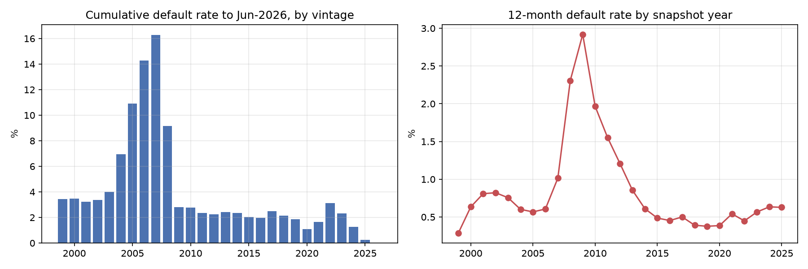
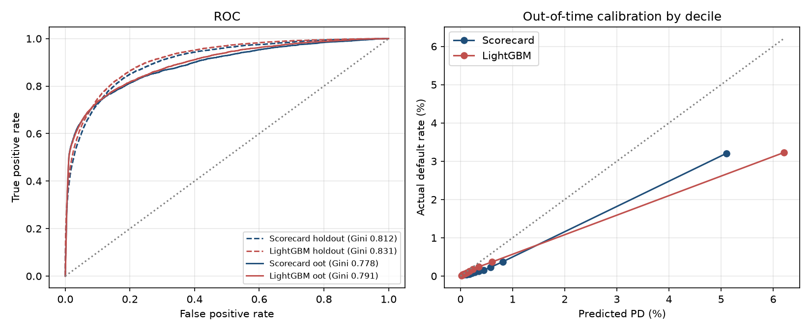
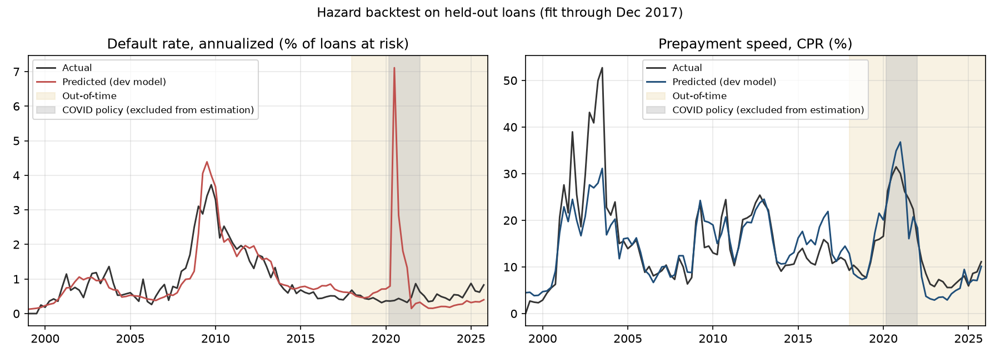
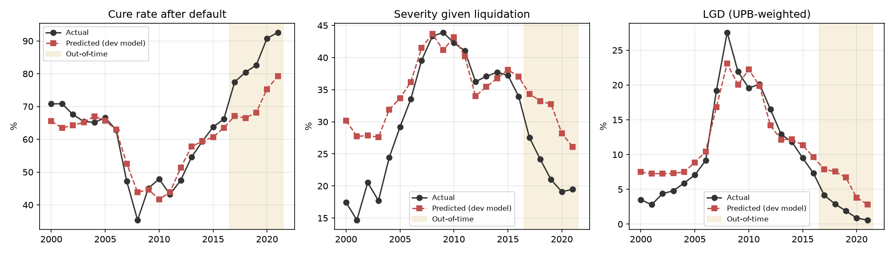
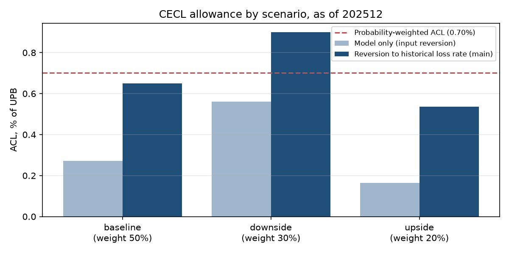
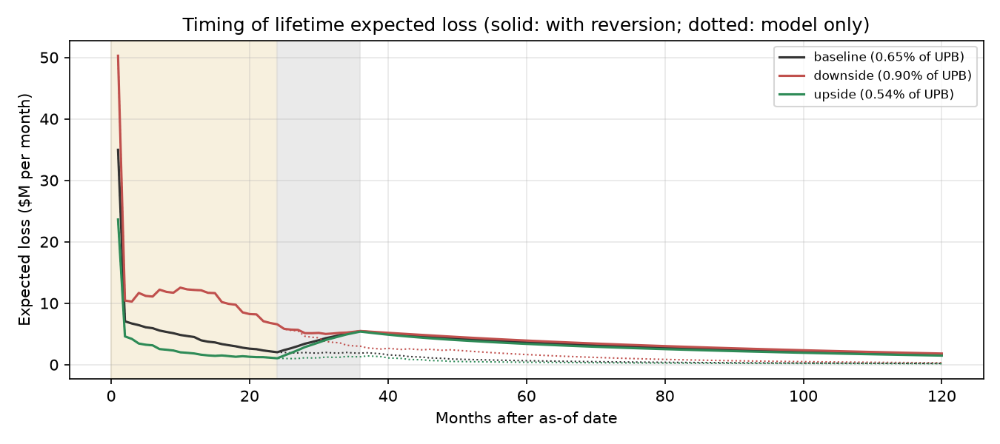
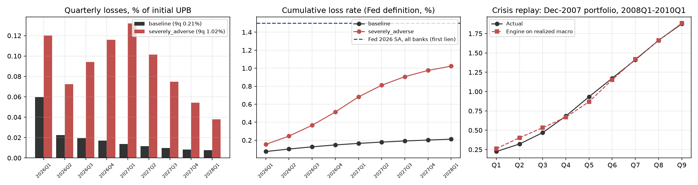

# Executive summary

This document describes a loan-level credit loss engine for US first-lien single-family mortgages, used for two purposes:
the **CECL allowance** (ASC 326) and **DFAST-style supervisory stress projections**. Both uses share one set of models:

- a **12-month PD scorecard** (WoE logistic regression) used for ranking and monitoring;
- a **lifetime competing-risk hazard** for monthly default and prepayment, driven by the Federal Reserve's own scenario variables;
- a two-part **LGD** model (probability of cure × fractional-logit severity) and an **EAD** equal to the scheduled amortization balance;
- a monthly **projection engine** combining them to loan maturity.

**Key results.**

- **CECL:** the probability-weighted allowance is **{{phase5.acl_weighted_pct_upb:.2%}} of UPB** on {{phase5.portfolio.loans:,}} loans. The model-only allowance (without reversion to historical loss rates) is {{phase5.acl_weighted_model_only_pct_upb:.2%}}.
- **DFAST:** under the 2026 severely adverse scenario, the 9-quarter loss rate is **{{phase6.results.severely_adverse.loss_rate_fed_def:.2%}}**, against {{phase6.results.baseline.loss_rate_fed_def:.2%}} under the baseline. The Federal Reserve's all-bank first-lien figure is {{phase6.fed_benchmark.first_lien_loss_rate_sa:.1%}}.
- **Validation evidence:**
  - out-of-time scorecard Gini {{sc.oot.gini:.3f}}
  - out-of-time prepayment actual/predicted {{phase3.backtest_oot.prepay_actual_to_pred:.2f}}
  - a replay of the 2008–2010 crisis reproducing realized losses ({{phase6.crisis_replay.pred_loss_rate_fed_def:.2%}} predicted vs {{phase6.crisis_replay.actual_loss_rate_fed_def:.2%}} actual)
  - an untouched Jan–Jun 2026 backtest

**Most material judgments:**

- the historical loss window used for CECL reversion (D-035), which moves the allowance more than any other parameter;
- the post-2013 servicing-regime assumption in LGD (D-031, D-040);
- the exclusion of COVID policy months from hazard estimation (D-024).

Known limitations are in Section 9.

# 1. Purpose, scope and use

**Intended use.** Estimate lifetime expected credit losses for the CECL allowance and project 9-quarter credit losses under
supervisory scenarios, for a portfolio of conforming fixed- and adjustable-rate first-lien mortgages.

**In scope:** loan-level PD, prepayment, LGD, EAD; scenario-conditional projection; allowance and stress-loss aggregation.

**Out of scope:**

- jumbo, subprime, HELOC and junior liens;
- pre-provision net revenue, capital ratios and balance-sheet dynamics;
- quantified qualitative adjustments (Q-factors);
- independent validation, which a model developer cannot perform on their own model.

**Model risk tier (proposed).** High materiality: the model drives a financial-statement estimate and a regulatory exercise
(SR 26-2 materiality: exposure and purpose).

# 2. Data

## 2.1 Sources

| Source | Content | Use |
|---|---|---|
| Freddie Mac SFLLD, sample files (Release 48) | {{phase1.totals.loans:,}} loans, monthly performance through {{phase1.totals.max_period}}, actual loss fields | All models |
| Federal Reserve 2026 DFAST files | Historic and scenario paths (unemployment, mortgage rate, Z.1 house prices) | Hazard drivers, CECL and DFAST scenarios |
| Freddie Mac House Price Index (FMHPI) | Monthly state and national indices | Mark-to-market LTV; state betas |
| FRED | 30-year mortgage rate (PMMS), unemployment, recession dates | Refinance incentive, checks |

## 2.2 Processing and data quality

Raw pipe-delimited files are read as text and cast with strict typing against the Release 48 layout (D-002), so layout drift
fails rather than producing silent nulls. Conversion took {{phase1_convert.seconds:.0f}} seconds with {{phase1_convert.peak_rss_gb:.1f}} GB peak memory
({{phase1_convert.raw_gb:.1f}} GB of text to {{phase1_convert.parquet_gb:.2f}} GB of parquet). Checks performed:

- {{phase1.totals.dup_loan_months}} duplicate loan-months;
- {{phase1.totals.loans_with_gaps}} loans with month gaps ({{phase1.totals.missing_months:,}} missing loan-months), kept, because events are keyed on period;
- {{phase1.totals.unknown_zb_loans}} unknown zero-balance codes;
- the loss identity (UPB + accrued interest + expenses + recoveries = actual loss, recoveries stored as negatives) holds for {{phase1.totals.loss_identity_pass:,}} of {{phase1.totals.dispositions_with_loss:,}} liquidations with loss data.

## 2.3 Target definitions

- **Default** (D-003): the first month with 90+ days past due, REO acquisition, or a default-type zero-balance code (02/03/09/15). Default is absorbing.
- **Forbearance** (D-004): 90+ DPD months during forbearance, payment deferral or disaster relief do not trigger default. Without this, 12-month default rates for snapshots taken in 2019 and 2020 ({{phase1.by_snapshot_year.20.pd_spec_def:.2%}}, {{phase1.by_snapshot_year.21.pd_spec_def:.2%}}) would approach the 2009 peak ({{phase1.by_snapshot_year.10.pd_spec_def:.2%}}) despite negligible losses. With it, they are {{phase1.by_snapshot_year.20.pd:.2%}} and {{phase1.by_snapshot_year.21.pd:.2%}}. The flags exist only from 2014.
- **Prepayment** (D-005): voluntary payoff with scheduled term remaining.
- **Censoring** (D-006): reperforming-loan sales, defects, maturity, and loans active at the cutoff.

{{vintage_table}}

# 3. 12-month PD scorecard

**Method.** The scorecard is fitted on yearly loan snapshots (D-007).

- Monotonic WoE binning (D-014), with minimum-bin exceptions for rare high-risk states (D-018).
- Selection: IV ≥ {{cfg.pd.iv_min}}, a correlation filter, and backward elimination on wrong signs and on p-values using loan-clustered standard errors (D-015).
- Era-proxy features are excluded on training-only evidence (D-019).
- Samples: fit on 80% of loans from 1999–2014, an in-time holdout on the other 20%, and an out-of-time test on 2015–2019 vintages (D-012).

{{pd_table}}

The out-of-time Gini's 95% loan-clustered bootstrap interval is {{phase2.scorecard.oot_gini_ci95.0:.3f}}–{{phase2.scorecard.oot_gini_ci95.1:.3f}}. Score PSI between development and out-of-time is
{{phase2.scorecard.psi_score_fit_vs_oot:.3f}}.

**Robustness:**

| Check | Out-of-time Gini |
|---|---:|
| Calendar split (training snapshots ≤ 2013, testing ≥ 2015) | {{phase2.robustness.calendar_split.gini:.3f}} |
| Origination-only features | {{phase2.robustness.origination_only.gini:.3f}} |
| Loans current at the snapshot | {{phase2.robustness.oot_current_loans_only.gini:.3f}} |

**Challenger.** A monotone-constrained LightGBM adds {{phase2.gini_uplift_lgbm_minus_scorecard_oot:+.3f}} Gini (D-016). The scorecard is retained
for transparency and stability.

**Calibration.** Out-of-time actual/predicted is {{phase2.scorecard.oot_actual_to_pred:.2f}}: the scorecard reflects through-the-cycle
risk from a crisis-inclusive training period. A leakage-free recalibration test (fit on 2015–2017, test on 2019 onward) is
documented (D-020). Point-in-time PD levels for CECL come from the macro-driven hazard, not the scorecard.

# 4. Lifetime default and prepayment hazard

**Specification (D-021, D-022).** A monthly multinomial logit models survive, default and prepay as competing risks, giving
S(t) = Π(1 − h_d − h_p).

- **Drivers:** loan age (piecewise linear), origination risk (FICO, CLTV, DTI, rate spread, loan size, purpose, occupancy, single borrower), and three scenario variables:
  - unemployment (level and 4-quarter change, Fed definition);
  - the refinance incentive against the mortgage rate;
  - mark-to-market LTV from state house prices.
- **Estimation:** choice-based sampling with corrected constants (D-023). COVID policy months are excluded from estimation (D-024), and there is no forbearance covariate (D-025).

**Backtest.** The development model is fitted through 2017 and tested on held-out loans.

- **In-time:** default actual/predicted {{phase3.backtest_in_time.default_actual_to_pred:.2f}}, prepay {{phase3.backtest_in_time.prepay_actual_to_pred:.2f}}.
- **Out-of-time, 2018–2025:** prepayment actual/predicted is {{phase3.backtest_oot.prepay_actual_to_pred:.2f}}. Default is {{phase3.backtest_oot.default_actual_to_pred:.2f}} overall:
  - COVID policy months come in at {{phase3.backtest_covid_only.default_actual_to_pred:.2f}};
  - loans with forbearance history produce a large share of later defaults (handled as an overlay, D-026);
  - for loans never in forbearance, post-COVID actual/predicted is {{phase3.backtest_post_covid_never_forbearance_by_vintage.<=2019.default_actual_to_pred:.2f}}, {{phase3.backtest_post_covid_never_forbearance_by_vintage.2020-2021.default_actual_to_pred:.2f}} and {{phase3.backtest_post_covid_never_forbearance_by_vintage.2022+.default_actual_to_pred:.2f}} by vintage group.

{{hz_year_table}}

**Stress sensitivities (production model):**

| Shock | Default multiplier | Prepay multiplier |
|---|---:|---:|
| Unemployment +2 pts | {{phase3.sensitivities_prod.ur_plus_2pt.default_multiplier:.2f}} | {{phase3.sensitivities_prod.ur_plus_2pt.prepay_multiplier:.2f}} |
| House prices −20% | {{phase3.sensitivities_prod.hpi_minus_20pct.default_multiplier:.2f}} | {{phase3.sensitivities_prod.hpi_minus_20pct.prepay_multiplier:.2f}} |
| Mortgage rate −1 pt | {{phase3.sensitivities_prod.mortgage_rate_minus_1pt.default_multiplier:.2f}} | {{phase3.sensitivities_prod.mortgage_rate_minus_1pt.prepay_multiplier:.2f}} |

# 5. Loss given default and exposure at default

**Structure (D-027).** E[LGD] = (1 − P(cure)) × E[severity | liquidation], developed on resolved defaults through 2021.

- **Severity:** measured on principal, with UPB at default as the denominator, undiscounted (D-029).
- **Drivers:** mark-to-market LTV at default, the forward 12-month house-price path (D-030), real (HPI-deflated) loan size (D-041), MI coverage, foreclosure timeline, and property and occupancy type.
- **Cure model:** adds a post-2013 servicing-regime indicator; unemployment is excluded (D-031).

**Results.**

- **In-sample (defaults ≤ 2016):** LGD {{phase4.train.lgd_actual_upb_weighted:.1%}} actual vs {{phase4.train.lgd_pred_upb_weighted:.1%}} predicted.
- **Out-of-time (2017–2021):** the model is conservative.
  - severity {{phase4.test_oot.severity_pred:.1%}} predicted vs {{phase4.test_oot.severity_actual:.1%}} actual;
  - LGD {{phase4.test_oot.lgd_pred_upb_weighted:.1%}} predicted vs {{phase4.test_oot.lgd_actual_upb_weighted:.1%}} actual.
- **Stress response:** house prices −20% at default raise LGD ×{{phase4.sensitivities_prod.hpi_minus_20pct:.2f}}.
- **EAD (D-032):** actual UPB at default / scheduled balance 12 months earlier = {{phase4.ead.ead_factor_upb_weighted:.3f}} ({{phase4.ead.n:,}} defaults).

{{lgd_year_table}}

# 6. CECL allowance

**Method.** Each loan is projected monthly to maturity, with expected loss = survival × default hazard × LGD × scheduled balance.

- **Contractual term:** adjusted for expected prepayments through the competing-risk hazard.
- **Scenarios (D-033):** three, built from the Fed's 2026 scenarios. The baseline is the Fed baseline; the downside is halfway to the severely adverse scenario; the upside is the mirror of the downside, with unemployment floored.
- **Weights:** {{phase5.scenarios.baseline.weight:.0%}} / {{phase5.scenarios.downside.weight:.0%}} / {{phase5.scenarios.upside.weight:.0%}} (baseline / downside / upside).
- **Forecast horizon:** a reasonable-and-supportable period of {{phase5.method.rs_quarters}} quarters (D-034), then {{phase5.method.reversion_quarters}}-quarter straight-line reversion to the historical annual loss rate of {{phase5.hist_annual_loss_rate:.3%}} (2000–2021, D-035).
- **Overlays (D-036):** loans that are delinquent or have a forbearance or prior-default history at the as-of date get hazard multipliers, calibrated relative to clean loans on past year-ends. Loans already in default take LGD only.

The ACL is undiscounted (a non-DCF method) on the sample portfolio (D-037).

{{cecl_table}}

**By segment and the Jan–Jun 2026 backtest.** This is data never used in development. Over all segments, actual defaults
were {{phase5.backtest_2026h1.defaults_actual:,}} against {{phase5.backtest_2026h1.defaults_pred:,.0f}} predicted, and prepayments came in at {{phase5.backtest_2026h1.prepay_actual_to_pred:.2f}}× predicted.

{{seg_table}}

**Sensitivity.** The historical loss window dominates; weights, R&S length and reversion speed matter far less.

{{sens_table}}

# 7. DFAST stress projection

The portfolio as of {{phase5.as_of}} is projected over 2026Q1–2028Q1 under the Fed's published baseline and severely adverse paths
(D-038). The severely adverse path peaks at {{phase6.scenario_summary.ur_peak_sa:.1f}}% unemployment, with a national house-price change of {{phase6.scenario_summary.hpi_trough_change_sa:.0%}}
at the trough. The loss rate follows the Fed definition: cumulative loss over average balance.

{{dfast_table}}

**Crisis replay (D-039).** The Dec-2007 portfolio is run on the realized 2008–2010 path: predicted {{phase6.crisis_replay.pred_loss_rate_fed_def:.2%}} vs actual
{{phase6.crisis_replay.actual_loss_rate_fed_def:.2%}}, with LGD {{phase6.crisis_replay.pred_lgd:.1%}} vs {{phase6.crisis_replay.actual_lgd:.1%}}. The models were estimated on data that includes this
period, so the replay validates aggregation and calibration under stress, not out-of-sample forecasting.

**Benchmark.** The severely adverse loss rate is {{phase6.sa_vs_fed_benchmark_ratio:.2f}}× the Fed's all-bank first-lien figure. The differences are expected:

- this is a GSE conforming book, with MI on high-LTV loans;
- the servicing-regime assumption keeps cure rates high;
- the models are different.

**Downturn LGD (D-040).** Severely adverse LGD remains below the realized 2008–2010 LGD ({{phase6.downturn_lgd.realized_lgd_2008_2010_upb_wtd:.1%}}).
Switching off the servicing regime is reported as the downturn sensitivity.

# 8. Validation evidence and traceability

The test suite has {{tests.passed}} of {{tests.total}} tests passing (`pytest`). They cover:

- target definitions on hand-built loans;
- the layout contract;
- metric functions against independent references;
- scorecard mechanics;
- sampling correction;
- the projection engine against a closed form;
- reversion blending;
- the number guardrail and its retry loop.

Each regulatory requirement below is mapped to its implementation, tests and evidence (D-045). Assessments are the developer's own.

{{trace_table}}

# 9. Limitations, assumptions and use restrictions

1. **Portfolio coverage.** GSE conforming loans with MI on high-LTV loans; not representative of jumbo, portfolio or subprime books.
2. **Forbearance.** Forbearance and disaster flags exist only from 2014, so earlier relief episodes follow the strict default definition.
3. **Through-the-cycle levels.** The hazard over-predicts clean-loan defaults in benign years (calibration-year actual/predicted {{phase5.overlay_s0_actual_to_pred:.2f}}), which is conservative.
4. **LGD.** Conservative in 2017–2021. It relies on a servicing-regime assumption never observed in a severe recession, and stress LGD stays below the 2008 peak unless that assumption is switched off.
5. **Reversion.** The allowance is highly sensitive to the historical loss window; that choice belongs to the allowance committee.
6. **Residual era proxy.** The hazard model still uses nominal loan size (small coefficients, clean out-of-time backtest).
7. **COVID.** Policy months are excluded from estimation. If similar policy support recurs, the model will overstate losses, which is a qualitative-adjustment matter.
8. **Sample portfolio.** Dollar amounts refer to the Freddie Mac sample; ratios are the meaningful outputs.
9. **Use restriction.** Not validated for jumbo, HELOC or commercial portfolios, or for horizons beyond the projection engine's {{cfg.cecl.max_horizon_months}}-month cap.

# 10. Ongoing monitoring plan

| Metric | Watch | Action |
|---|---|---|
| Score PSI (development vs current) | > {{cfg.monitoring.psi_watch}} | > {{cfg.monitoring.psi_action}}: investigate and consider redevelopment |
| Out-of-time Gini | — | Drop > {{cfg.monitoring.gini_drop_action}} vs {{sc.oot.gini:.3f}} |
| Actual/predicted defaults and prepayments by segment | Outside {{cfg.monitoring.actual_to_pred_band.0}}–{{cfg.monitoring.actual_to_pred_band.1}} for two consecutive quarters | Recalibrate overlay or hazard |
| LGD actual/predicted on resolved defaults | Outside {{cfg.monitoring.actual_to_pred_band.0}}–{{cfg.monitoring.actual_to_pred_band.1}} | Review servicing regime and severity drivers |

Monitoring frequency: {{cfg.monitoring.frequency}}.

# 11. LLM reporting layer (supporting tool, not a model input)

A local LLM (Ollama, `{{cfg.llm.chat_model}}`, embeddings `{{cfg.llm.embed_model}}`, FAISS) supports documentation.

- **Regulatory Q&A** is retrieval-augmented over the indexed sources.
- **Draft narrative:** the LLM drafts narrative from code-formatted facts, under a number guardrail and a citation check (D-043).
- **Out of scope for SR 26-2:** generative AI falls outside the guidance (SR 26-2), so the control is the guardrail plus a logged human review.

**Result of that review:** drafts that passed the automated checks still contained inverted interpretations and misattributed
regulatory support (`docs/mdd/review_log.md`, D-047). No LLM-drafted text is used in this document.

{{eval_table}}

# Appendix A. Decision index

{{n_decisions}} documented decisions, each with rejected alternatives in `DECISIONS.md`.

{{decisions_table}}

# Appendix B. Reproducibility

- **Run:** `make all` reruns phases 1–6 and the tests from raw data; `make llm` reruns the LLM layer; `make reports` renders this document.
- **Inputs:** every parameter, path, URL and the random seed ({{cfg.seed}}) are in `config.yaml`.
- **Downloads:** public files are hashed in `data/raw/manifest_public.json`.
- **Data:** raw data is not distributed (Freddie Mac terms); see the README for download steps.
